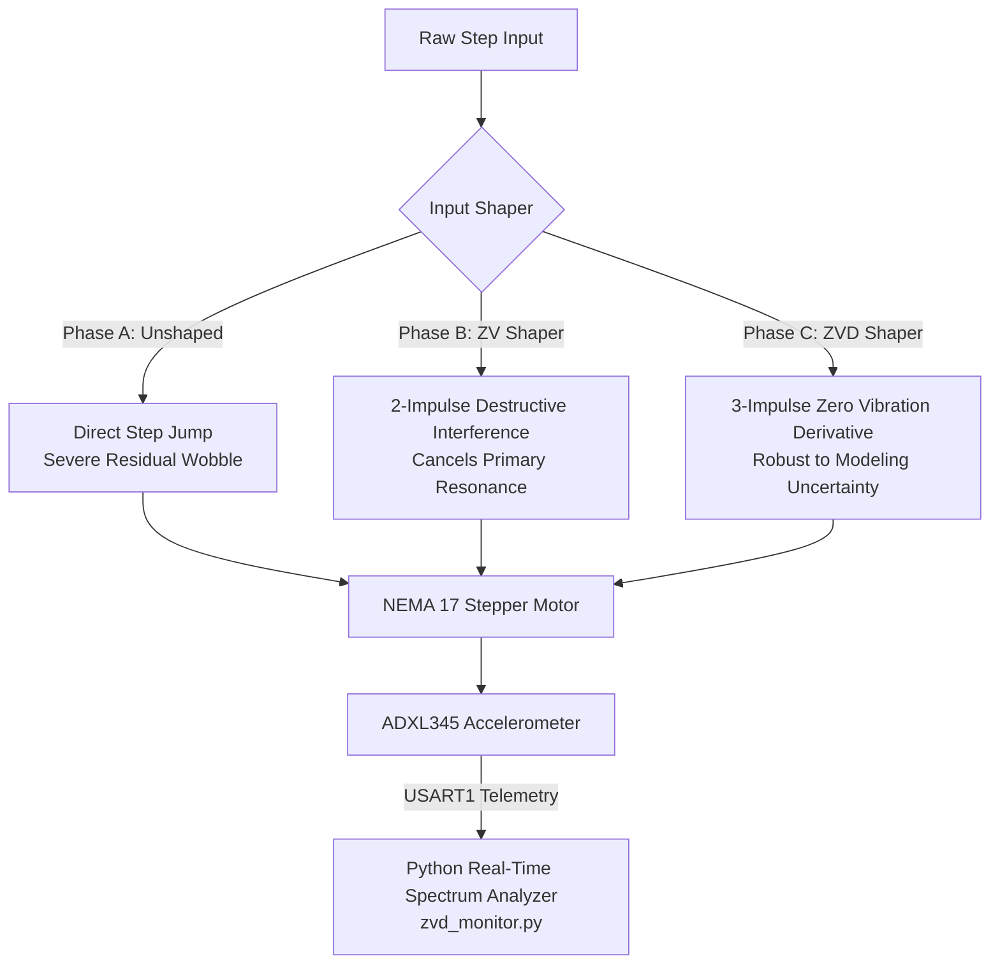

# ⚡ ZVD Input Shaping & Active Vibration Suppression System

[](https://www.st.com/)
[](https://developer.arm.com/)
[](https://www.analog.com/)
[](https://allegromicro.com/)
[](https://python.org/)
[](https://opensource.org/licenses/MIT)

A bare-metal embedded control system demonstrating **Zero Vibration (ZV)** and **Zero Vibration Derivative (ZVD)** input shaping techniques to cancel mechanical resonance and residual vibration in stepper-driven kinematic mechanisms.

Implemented directly via register-level C on the **STM32F401 Black Pill**, benchmarked with a **NEMA 17 stepper motor / A4988 driver**, and validated with real-time acceleration telemetry from an **ADXL345 3-axis accelerometer**.

---

## 📌 Control Theory: Input Shaping

Input shaping convolves a command trajectory with a sequence of impulses designed to create destructive interference with the structural resonance modes of the flexible system:

$$\text{Impulse Sequence: } \quad \{A_i, t_i\}_{i=1}^N$$



### Motion Profile Comparison:
1. **Phase A (Unshaped Profile)**: Instantaneous acceleration profile, inducing strong structural oscillations at natural frequency $\omega_n$.
2. **Phase B (ZV Shaper)**: Two-impulse sequence spaced by half the damped vibration period:
   $$\Delta t = \frac{\pi}{\omega_d}$$
3. **Phase C (ZVD Shaper)**: Three-impulse sequence providing zero slope at resonance $\frac{dV}{d\omega} = 0$, ensuring robustness against payload mass or stiffness variations.

---

## 🔌 Hardware Pinout & Wiring

| Module | STM32 Pin | Register / Interface |
| :--- | :--- | :--- |
| **A4988 STEP** | `PA1` | GPIO Output (BSRR toggling) |
| **A4988 DIR** | `PA2` | GPIO Output |
| **A4988 ENABLE** | `PA3` | GPIO Output (Active Low) |
| **ADXL345 SCL** | `PB8` / `PB6` | I2C / SPI Clock |
| **ADXL345 SDA** | `PB9` / `PB7` | I2C / SPI Data |
| **Telemetry TX** | `PA9` | `USART1_TX` (High-speed telemetry stream) |
| **Onboard LED** | `PC13` | Phase transition indicator |

---

## 📁 Repository Structure

```text
├── README.md                   # Documentation & control theory guide
├── requirements.txt            # Python telemetry dependencies
├── .gitignore                  # Ignore compilation binaries and caches
├── linker.ld                   # Bare-metal ARM Cortex-M4 linker script
├── linker_sensor.ld            # Linker script with dedicated telemetry RAM buffer
├── zvd_main.c                  # Integrated ZVD 3-phase demonstration firmware
├── zvd_v2.c / zvd_v3.c         # Advanced continuous trajectory shapers
├── zvd_monitor.py              # Real-time vibration & FFT spectrum monitor
├── adxl_stream.c               # High-frequency ADXL345 streaming firmware
├── adxl_monitor.py             # Accelerometer waveform visualizer
├── live_stroke_streamer.py     # Live stroke telemetry parser
├── sudden_brake.c              # Deceleration dynamics and braking analysis
└── snap_wobble.c               # Resonance excitation benchmark
```

---

## 🚀 Usage & Telemetry

### 1. Build Firmware (ARM GCC Toolchain)
Compile using the bare-metal ARM GNU toolchain:
```bash
arm-none-eabi-gcc -mcpu=cortex-m4 -mthumb -mfloat-abi=hard -mfpu=fpv4-sp-d16 \
  -T linker_sensor.ld -nostdlib zvd_main.c -o zvd_main.elf
arm-none-eabi-objcopy -O binary zvd_main.elf zvd_main.bin
```

### 2. Flash to STM32
Flash via ST-Link:
```bash
st-flash write zvd_main.bin 0x08000000
```

### 3. Launch Real-Time Vibration Telemetry Monitor
```bash
python3 -m venv venv
source venv/bin/activate
pip install -r requirements.txt
python3 zvd_monitor.py
```
*(Displays live time-domain acceleration curves, peak deceleration transients, and residual oscillation settling times across Unshaped, ZV, and ZVD test sequences).*
